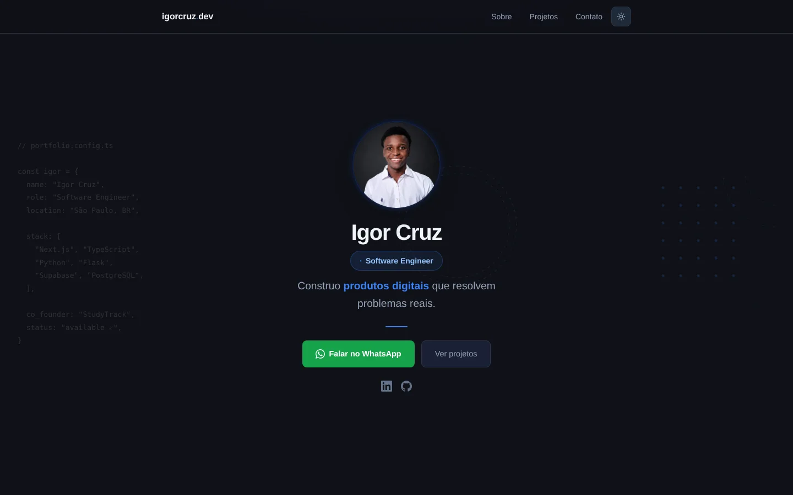

# igorcruz.com.br — portfólio

[](https://github.com/IgorCruz-dev/portfolio/actions/workflows/ci.yml)
[](https://nextjs.org/)
[](tsconfig.json)
[](LICENSE)

**Meu site pessoal: quem eu sou, o que construí e como falar comigo.**
Uma página só, rápida, com tema claro/escuro e feita para levar o visitante a
uma conversa (WhatsApp, e-mail ou LinkedIn).

🔗 **No ar:** [igorcruz.com.br](https://www.igorcruz.com.br)



## Seções

| Seção | Conteúdo |
|---|---|
| Hero | Apresentação, stack em formato de código e CTAs de contato |
| Sobre | Formação, trabalho e a StudyTrack, com números |
| Projetos | Cards com status (produto ativo, no ar, hackathon, protótipo), stack e link |
| Contato | WhatsApp, e-mail, LinkedIn e GitHub |

## Stack

| Camada | Tecnologia |
|---|---|
| Framework | Next.js 14 (App Router) |
| Linguagem | TypeScript |
| Estilo | Tailwind CSS + variáveis CSS para os temas |
| Animação | Framer Motion |
| Ícones | Lucide |
| Deploy | Vercel |

## Decisões técnicas

- **Tema sem "piscada".** Um script inline no `<head>` aplica o tema salvo
  antes da hidratação do React, então a página nunca abre no tema errado.
- **Uma página, sem backend.** Portfólio é conteúdo; não precisa de banco nem
  de API. Os projetos são uma lista tipada em `Projetos.tsx`.
- **Fontes otimizadas.** Inter via `next/font`, servida junto com o site, sem
  requisição ao Google no navegador do visitante.

## Rodando localmente

```bash
git clone https://github.com/IgorCruz-dev/portfolio
cd portfolio
cp .env.example .env.local
npm install
npm run dev        # http://localhost:3000
```

| Comando | O que faz |
|---|---|
| `npm run dev` | Servidor de desenvolvimento |
| `npm run build` | Build de produção |
| `npm run lint` | ESLint |
| `npm run typecheck` | Checagem de tipos (`tsc --noEmit`) |

## Estrutura

```
src/
  app/                 layout (metadados, Open Graph, tema) e a página
  components/portfolio/
    Navbar.tsx         navegação e alternância de tema
    Hero.tsx           apresentação e CTAs
    Sobre.tsx          bio e números
    Projetos.tsx       lista de projetos (edite aqui)
    ProjectCard.tsx    card de projeto
    Contato.tsx        canais de contato
public/assets/         foto e miniaturas dos projetos
```

## Licença

Código sob [MIT](LICENSE). Minha foto e as miniaturas dos projetos em
`public/assets/` não estão cobertas pela licença.

## Autor

**Igor Cruz** · [igorcruz.com.br](https://www.igorcruz.com.br) · [GitHub](https://github.com/IgorCruz-dev)
